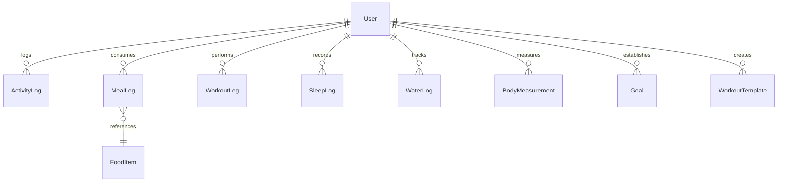

# FitPulse — Your Personal Fitness Intelligence Platform

[](https://www.typescriptlang.org/)
[](https://reactjs.org/)
[](https://www.mongodb.com/)
[](https://expressjs.com/)
[](https://tailwindcss.com/)
[](https://jestjs.io/)

> **FitPulse** is an enterprise-grade, full-stack MERN fitness, nutrition, and lifestyle intelligence web platform. Engineered for academic demonstration, technical interviews, and production deployment, FitPulse replaces superficial client-side state with genuine **MongoDB Aggregation Pipelines**, relational schema constraints, and biometric calculation engines.

---

## 1. Problem Statement & Objectives

Modern health-tracking web applications often suffer from two major flaws:
1. **Superficial Client-Side Mocking:** Visual dashboards that calculate summary statistics in client-side JavaScript memory, collapsing under large datasets.
2. **Disconnected Monolithic Logging:** Step counters, calorie trackers, and sleep monitors operating in isolation without cross-domain correlation.

### Core Objectives
- **MongoDB Aggregation First:** Execute all metric reductions, category distributions, training volumes, and cross-collection joins directly on the database engine.
- **Holistic Biometric Modeling:** Correlate caloric intake against walking and exercise expenditure, sleep consistency, and body measurements.
- **Strict Data Integrity:** Enforce schemas with compound indexes, unique constraints, and multi-tenant per-user data isolation.
- **Indian Food Catalog:** Starter database of 45+ nutritional items including traditional Indian staples (Roti, Dal, Paneer, Rajma, Idli, Dosa, Poha).

---

## 2. Technology Stack

### Frontend
- **Framework:** React 18 with Vite
- **Language:** TypeScript
- **Styling:** Tailwind CSS with Dark-Mode-First SaaS Palette
- **Components:** shadcn/ui design patterns, Lucide React icons
- **Visualizations:** Recharts (Bar, Area, Pie, Line) + Animated SVG Circular Progress Rings
- **State & HTTP:** Axios, Context API, TanStack Query

### Backend
- **Runtime:** Node.js 24+ & Express.js
- **Language:** TypeScript
- **Database ODM:** Mongoose 8.x
- **Authentication:** JWT with HttpOnly cookie support & bcrypt password hashing
- **Validation:** Zod schema contracts
- **Security:** Helmet, CORS, Express Rate Limiting

### Database
- **Engine:** MongoDB (Local or Atlas)
- **Features:** 10 Collections, Compound Indexes, Multi-Stage Aggregation Pipelines, Full-Text Search.

---

## 3. UI/UX Design System

FitPulse features a dark-mode fitness SaaS aesthetic:
- **Primary Background:** `#0B0F19`
- **Secondary Surface:** `#151B2B`
- **Card Background:** `#1C2435`
- **Primary Accent:** `#A3E635` (Electric Lime)
- **Secondary Accent:** `#8B5CF6` (Violet)
- **Success:** `#22C55E` | **Warning:** `#F59E0B` | **Error:** `#EF4444`
- **Typography:** Inter

---

## 4. Key Platform Features

1. **Interactive Overview Dashboard:**
   - 6 KPI Cards: Daily Steps, Calorie Balance, Hydration, Sleep Duration, Weekly Workouts, Macronutrients.
   - Dynamic charts: Weekly step cadence, caloric intake vs. total burned, macro distribution pie chart, habit consistency index.
2. **Activity & Steps Tracker:**
   - Daily step logging with automated stride estimation formula:
     $$\text{Distance (km)} = \text{Steps} \times \frac{\text{Height (cm)} \times 0.414}{100,000}$$
   - Walking caloric expenditure estimation based on body weight.
   - Multi-day streak calculation.
3. **Nutrition & Macro Tracker:**
   - Categorized meal logs (Breakfast, Lunch, Dinner, Snacks, Drinks).
   - Searchable catalog with 45+ foods including Indian staples.
   - User custom food creator.
   - Automatic macro summation (calories, protein, carbs, fats, fiber).
4. **Workout Tracker & Progressive Overload:**
   - Strength training, cardio, running, cycling, yoga, mobility.
   - Exercise set logger (reps, weight, rest time).
   - Reusable workout templates.
   - Automated training volume calculation ($V = \sum \text{reps} \times \text{weight}$).
5. **Sleep Monitoring:**
   - Midnight-crossing duration calculation (e.g. 23:30 to 07:15 = 480 mins).
   - 1-5 star sleep quality rating.
   - Sleep consistency score based on standard deviation ($\text{stdDevPop}$).
6. **Hydration Tracker:**
   - Quick-add buttons (+100ml, +250ml, +500ml) & custom volume input.
   - Circular progress ring & weekly hydration chart.
7. **Body Measurements:**
   - Weight, waist, hip, chest, arm, and thigh progression.
   - Automatic user profile sync.
   - Interactive trend line chart.
8. **Fitness Goals Management:**
   - Configurable targets across all 7 health domains.
   - Live progress bars and percentage calculation.
9. **Advanced Analytics & Leaderboard:**
   - Visual aggregation pipeline explorer.
   - Privacy-preserving community step leaderboard.

---

## 5. MongoDB Database Architecture

### Entity Relationship & Collections Overview



### The 10 Collections
1. `users`: User identity, biometric baselines, preferences.
2. `activity_logs`: Daily step entries with unique index `{ userId: 1, date: -1 }`.
3. `food_items`: Nutritional catalog with full-text search index `{ name: 'text', category: 'text' }`.
4. `meallogs`: Meal logs embedding nutritional snapshots.
5. `workoutlogs`: Exercise sessions embedding sets and weights.
6. `sleep_logs`: Sleep sessions with ISO timestamps.
7. `water_logs`: Granular hydration timestamps.
8. `body_measurements`: Anthropometric history.
9. `goals`: Active & historical targets.
10. `workout_templates`: Pre-configured workout routines.

---

## 6. The 8 MongoDB Aggregation Pipelines

All 8 pipelines are implemented in `backend/src/services/analyticsService.ts`:
- **Pipeline 1 — Weekly Step Analysis:** Groups steps by calendar day, computing totals and summary statistics (`$group`, `$project`, `$round`).
- **Pipeline 2 — Nutrition Analysis:** Unwinds meal items and aggregates macros across meal types (`$unwind`, `$group`, `$sum`).
- **Pipeline 3 — Workout Volume Analysis:** Multiplies reps by weight to calculate exercise volume and category distribution (`$unwind`, `$multiply`, `$group`).
- **Pipeline 4 — Sleep Consistency:** Computes mean duration and variance using `$stdDevPop`.
- **Pipeline 5 — Calorie Balance Join:** Cross-collection join via `$lookup` between `activity_logs`, `meallogs`, and `workoutlogs`.
- **Pipeline 6 — Monthly Progress:** Extracts calendar month (`$substr`) and computes monthly step sums and weight change.
- **Pipeline 7 — Activity Leaderboard:** Multi-user step ranking with display name anonymization (`$concat`, `$split`, `$substrCP`).
- **Pipeline 8 — Lifestyle Consistency Score:** Algorithmic composite habit adherence score (0-100) across 5 weighted domains.

---

## 7. Local Installation & Execution Guide

### Prerequisites
- **Node.js:** v18.0.0 or higher (v24 tested)
- **MongoDB:** Local MongoDB Server (running on `mongodb://127.0.0.1:27017`) or a free MongoDB Atlas connection string.

### PowerShell Setup Commands (Windows)

```powershell
# 1. Clone repository and navigate to fitpulse
cd fitpulse

# 2. Install backend dependencies
cd backend
npm install

# 3. Install frontend dependencies
cd ../frontend
npm install

# 4. Return to root
cd ..
```

### Environment Configuration

In `backend/.env`:
```ini
PORT=5000
NODE_ENV=development
MONGODB_URI=mongodb://127.0.0.1:27017/fitpulse
JWT_SECRET=fitpulse_super_secret_jwt_key_academic_demonstration_2026_xyz
JWT_EXPIRES_IN=7d
CLIENT_URL=http://localhost:5173
```

In `frontend/.env`:
```ini
VITE_API_BASE_URL=/api
```

---

## 8. Database Seeding & Demo Account

FitPulse includes a comprehensive seed script that populates **30 days of consistent biometric data**:

```powershell
# Run seed script from backend directory
cd backend
npm run seed
```

### Demonstration Credentials
- **Email:** `demo@fitpulse.app`
- **Password:** `Password123!`
- *(Or simply click the **"Quick Fill Demo Account"** button on the Login page).*

---

## 9. Running Tests

FitPulse features an automated test suite verifying security, calculations, midnight crossing, and aggregation pipelines:

```powershell
cd backend
npm test
```

### Test Results
```text
PASS tests/api.test.ts
  1. Authentication & Security Tests (6 tests passed)
  2. Activity & Steps Endpoint Tests (3 tests passed)
  3. Nutrition & Meal Tracking Tests (1 test passed)
  4. Workout Tracking Tests (1 test passed)
  5. Sleep Tracking & Midnight Crossing Tests (2 tests passed)
  6. Hydration Tracking Tests (1 test passed)
  7. MongoDB Aggregation Analytics Tests (2 tests passed)

Test Suites: 1 passed, 1 total
Tests:       16 passed, 16 total
```

---

## 10. Running the Application Locally

Open two terminal windows:

### Terminal 1: Backend API
```powershell
cd backend
npm run dev
# Starts API server on http://localhost:5000
```

### Terminal 2: Frontend Web App
```powershell
cd frontend
npm run dev
# Opens Vite development server on http://localhost:5173
```

Navigate your browser to `http://localhost:5173`.

---

## 11. University Presentation Walkthrough Guide

Follow this sequence for an academic project evaluation:
1. **Login Page (`/login`):**
   - Click "Quick Fill Demo Account" to authenticate as `demo@fitpulse.app`.
2. **Dashboard Overview (`/`):**
   - Showcase the 6 live KPI cards populated from MongoDB.
   - Highlight the interactive Recharts (Weekly Step Cadence, Caloric Intake vs. Total Burned).
   - Change the calendar date picker to view historical entries.
3. **Activity Tracker (`/activity`):**
   - Demonstrate adding a new step log with automated stride and calorie calculation.
   - Edit and delete entries to show real-time database reactivity.
4. **Nutrition Tracker (`/nutrition`):**
   - Search the Indian food catalog for *Roti*, *Dal*, or *Paneer*.
   - Add items to a lunch log and observe automatic macro calculation.
5. **Workout Tracker (`/workouts`):**
   - Load a saved template ("Full Body Strength & Power").
   - Demonstrate multi-set weight logging and progressive overload volume calculation.
6. **Sleep Tracker (`/sleep`):**
   - Review sleep sessions crossing midnight and sleep consistency scoring.
7. **Hydration Tracker (`/hydration`):**
   - Tap "+250 ml" and "+500 ml" to show instant progress ring animation.
8. **Advanced Analytics (`/analytics`):**
   - Switch to the "Aggregation Pipelines" tab to explain the MongoDB aggregation architecture.
   - Switch to "Activity Leaderboard" to demonstrate multi-tenant aggregation and anonymization.

---

## 12. Deployment

FitPulse is production-ready for deployment:
- **Frontend:** Vercel (Vite preset, root: `frontend`)
- **Backend:** Render (Node web service, root: `backend`, command: `npm run build && npm start`)
- **Database:** MongoDB Atlas (M0/M10 cluster)

See [`docs/architecture.md`](docs/architecture.md) for full deployment instructions.

---

## 13. License
This project is developed for educational and portfolio demonstration under the MIT License.
