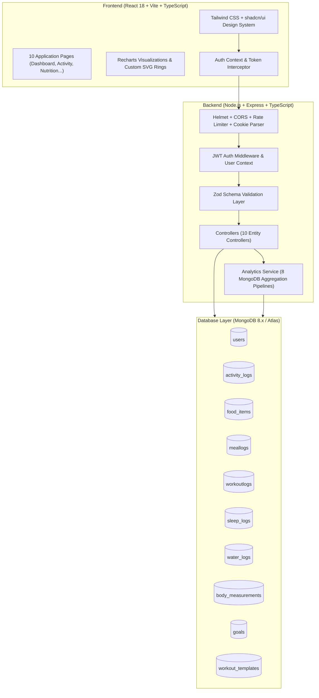

# FitPulse — System Architecture & Deployment Guide

## 1. High-Level Architecture Overview

FitPulse follows a modular, three-tier MERN micro-service friendly architecture designed for academic rigor, performance, and cloud scalability.

---

## 2. Security & Defense-in-Depth Layer

1. **Helmet HTTP Headers:** Sets `X-Content-Type-Options: nosniff`, `X-Frame-Options: SAMEORIGIN`, and strict Referrer Policies.
2. **Double-Guarded Authentication:**
   - Issues signed JSON Web Tokens (7-day TTL).
   - Transmits token inside `HttpOnly`, `SameSite: lax` cookies (in production: `SameSite: none; Secure: true`).
   - Supports fallback `Authorization: Bearer <token>` for programmatic API testing.
3. **Data Sanitization & Zod Contracts:** Validates every incoming payload before reaching Mongoose or memory.
4. **Rate Limiting:** Protects `/api/*` routes against brute-force or DoS attacks (500 requests per 15-minute window).
5. **Multi-Tenant User Isolation:** Every read, write, update, and delete query is filtered against `req.user.id`.

---

## 3. Production Deployment Guide

### Deployment Architecture
- **Frontend:** Hosted on **Vercel**
- **Backend API:** Hosted on **Render** (or Railway / AWS Elastic Beanstalk)
- **Database:** Hosted on **MongoDB Atlas** (Shared M0 or Dedicated M10 cluster)

### Step 1: MongoDB Atlas Setup
1. Create a free M0 cluster at [mongodb.com/atlas](https://www.mongodb.com/atlas).
2. Under "Database Access", create a database user (e.g. `fitpulse_admin`) with password.
3. Under "Network Access", allow IP access `0.0.0.0/0` (or Render's outbound IPs).
4. Copy the connection string:
   `mongodb+srv://fitpulse_admin:<password>@cluster0.abcde.mongodb.net/fitpulse?retryWrites=true&w=majority`

### Step 2: Render Backend Deployment
1. Connect your GitHub repository to Render as a **Web Service**.
2. Root Directory: `fitpulse/backend`
3. Environment: `Node`
4. Build Command: `npm install && npm run build`
5. Start Command: `npm start`
6. Environment Variables:
   - `PORT`: `5000`
   - `NODE_ENV`: `production`
   - `MONGODB_URI`: `<Atlas Connection String>`
   - `JWT_SECRET`: `<High entropy secret>`
   - `CLIENT_URL`: `https://your-fitpulse.vercel.app`

### Step 3: Vercel Frontend Deployment
1. Connect your GitHub repository to Vercel.
2. Root Directory: `fitpulse/frontend`
3. Framework Preset: `Vite`
4. Build Command: `npm run build`
5. Output Directory: `dist`
6. Environment Variables:
   - `VITE_API_BASE_URL`: `https://your-fitpulse-backend.onrender.com/api`
7. Click **Deploy**.
